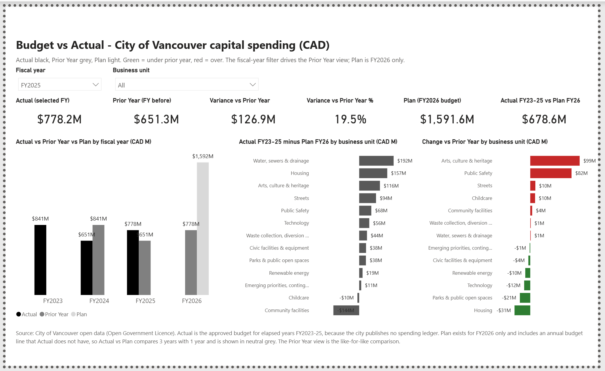
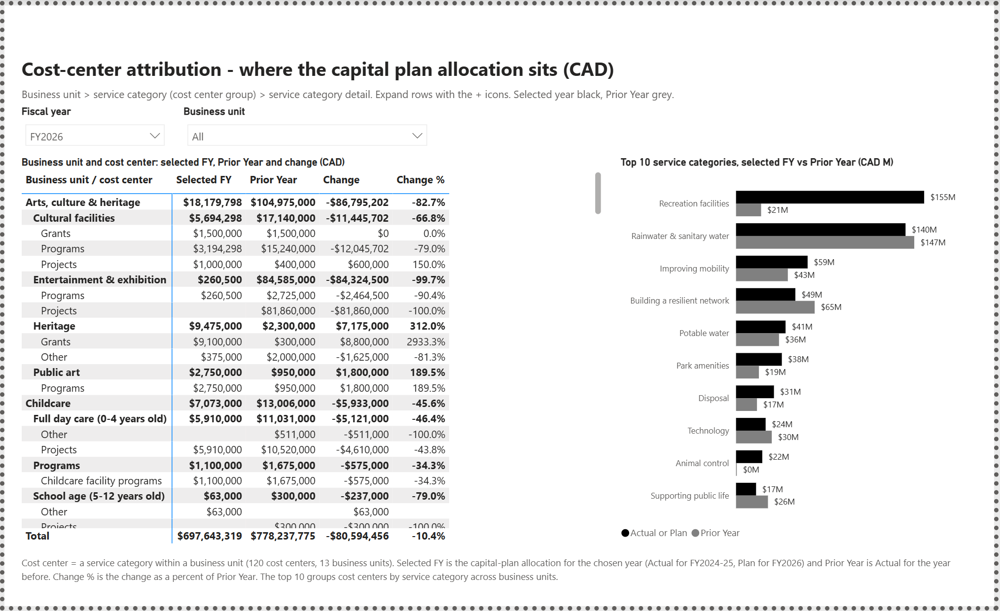

# Finance Power BI: BC Public-Sector Capital Budget Analytics (IBCS)

*An IBCS-compliant finance dashboard built on real public capital-budget data, so a public-sector finance team can read variance the way the standard intends - not as a rainbow of KPI cards.*

> **Status: two report pages built and running in Power BI Desktop (Nov 2026).** The Python data pipeline, the star-schema model, 15 DAX measures and two native-visual report pages (Budget vs Actual, Cost-center attribution) are built and open from the `pbip/` project. 9 Deneb custom-visual specs are a companion piece. Not yet done: publishing to the Power BI Service, row-level security, and small multiples inside the report.

## The report in Power BI Desktop



Page 1 answers "are we up or down, and against what". Actual is black, Prior Year grey, Plan light. Green and red appear only on the like-for-like Prior Year comparison. Actual vs Plan compares three years with one plan year, so it stays neutral grey and the page says why.



Page 2 answers "who is driving it": business unit down to service category, plus the top 10 service categories.

The charts further down this README are the Deneb (Vega-Lite) companion specs.


## Why this project

Most entry-level BI portfolios are a sales dashboard. That does not demonstrate finance fluency, and it does not demonstrate IBCS - the International Business Communication Standards that serious finance reporting follows. Finance teams at BC Hydro, ICBC, TransLink, WorkSafeBC, and the provincial health authorities run on Power BI, but most are Excel-first and short on analysts who can do honest variance reporting in the visual grammar finance actually uses. This is the piece I wanted to exist: a finance dashboard, on real public money, built to the standard.

## The data - real public money, not a toy dataset

The City of Vancouver Open Data portal publishes its capital project budget and multi-year capital plan as CSVs under the Open Government Licence. Together they give the full picture finance variance reporting needs in one source: a budget, an actual, multiple years, and multiple departments - roughly **CAD 8.6 billion** of planned capital across service categories, business units, and fiscal years. Real public money, real structure, reproducible by anyone without an NDA.

Honest framing: Vancouver does not publish a per-project actual-spend ledger, so "Actual" is documented as an approved-budget-for-an-elapsed-year proxy, not an audited spend figure. A finance reviewer should see that stated, not buried. The pipeline is test-covered - the modelled fact total reconciles to an independently re-parsed control total.

## The model and the IBCS grammar

A small Python pipeline unpivots the wide government spreadsheets into a clean star schema (one fact table plus account, period, cost-center, business-unit, and scenario dimensions) and maps each raw column onto the IBCS scenario set: Prior Year, Actual, Plan, Forecast.

The visuals follow IBCS notation: black for Actual, grey for Prior Year, outlined for Plan, hatched for Forecast; variance green when better and red when worse, never inverted by metric direction; at most three colors plus greyscale per page. That reads like a Zebra BI dashboard, but it is reproduced natively in Power BI + Deneb (9 specs: 8 Vega-Lite, plus a Vega cost-allocation Sankey, since Vega-Lite has no native Sankey mark) - so the work stays free and portable instead of leaning on a per-user custom-visual license.


## What it demonstrates

This project deliberately exercises the three hardest Power BI surfaces:

- **DAX** - 15 measures for actual-vs-plan and prior-year variance. Annual grain, no date table yet, so prior year and running totals are explicit `FILTER` shifts on `dim_period` (a marked date table with `SAMEPERIODLASTYEAR` / `DATESYTD` is the planned next step).
- **Row-Level Security** - `USERPRINCIPALNAME()` + cost-center role pattern, the one healthcare-finance teams actually need.
- **Custom Deneb visuals** - IBCS variance tables, waterfall bridge, small multiples, and a Vega Sankey, reproduced without a paid visual license.

## Results so far

- ~CAD 8.6B of City of Vancouver capital budget modelled across ~2,000 project-by-scenario-by-period rows, reconciled to source by an automated test.
- All four IBCS scenarios derived from the real columns; 120 cost centers across 13 business units and 9 fiscal years.
- 9 Deneb specs; pipeline + spec checks green in CI. The charts on the portfolio page are rendered from those specs against the real data via a small Python renderer.
- Honest limitation, stated not hidden: the City source has no single fiscal year carrying both an Actual and a Plan, so the like-for-like comparison shown is year-over-year (2025 Actual vs 2026 Plan), not a same-period Actual-vs-Plan variance.


## What I learned

- Mapping wide government budget files onto a clean PY/AC/PL/FC framework forces honest calls. Documenting the "Actual" proxy was more defensible than faking an actual-spend column the source does not have.
- IBCS is mostly restraint. The hard part is removing color and chartjunk, not adding it.
- Vega-Lite cannot express a Sankey, so the cost-allocation flow needed a raw Vega spec. Deneb supporting both is what made that possible without a paid visual.
- A full Power BI model can now be authored in the browser - semantic-model editing in the Power BI Service is GA, so this whole build runs on a Mac with no Windows.

## Repo layout

```
finance-powerbi/
├── data/raw/          # City of Vancouver capital open data CSVs (Open Government Licence)
├── data/processed/    # Power Query / Python-cleaned tables (incl. finance_capital_flat.csv)
├── deneb/             # 9 IBCS Deneb specs (8 Vega-Lite + 1 Vega Sankey) + reusable prompt + theme
├── docs/              # measures.md, model diagram, build-on-mac-online.md, data-sources.md
├── pbip/              # Power BI project (web-authored)
├── tests/             # reconciliation + spec checks (run green in CI)
└── README.md
```

## How to run the pipeline

```bash
python3 -m venv .venv && source .venv/bin/activate
pip install -r requirements.txt
python3 -m pytest          # reconciliation + spec checks
# render the Deneb specs against the real data via the project renderer (see docs/)
```

## Data & licence

City of Vancouver Open Data - capital project budget + multi-year capital plan, under the Open Government Licence - Vancouver. See `data-sources.md` for the canonical source list + attribution.

## Links

- Portfolio write-up (Notion): https://www.notion.so/3731d7ee04a181e6be67c20779c13957
- Power BI Service public link: _to be published at ship (2026-06-25)_
